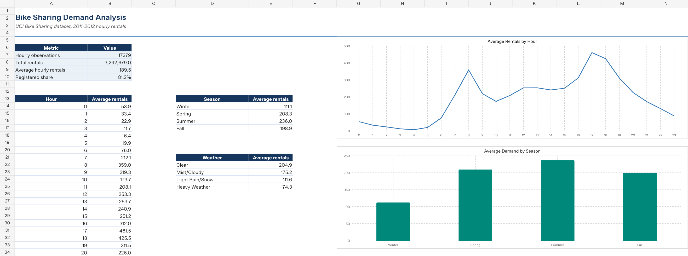

# Bike Sharing Demand Analysis

Bu projede bisiklet kiralama talebinin saat, gün tipi, mevsim ve hava koşullarına göre değişimi incelenmiştir. Çalışma, belirli bir iş ilanından bağımsız bir veri analizi portföy projesidir.

## Veri kaynağı

UCI Machine Learning Repository'deki Bike Sharing veri seti kullanılmıştır. İndirilen `hour.csv` dosyası Capital Bikeshare sisteminin 2011 ve 2012 yıllarındaki 17.379 saatlik kaydını içerir ve CC BY 4.0 lisansıyla paylaşılmıştır.

Kaynak ve lisans ayrıntıları `DATA_SOURCE.md` dosyasındadır.

## Kullanılan araçlar

- Python, pandas ve matplotlib
- Oracle uyumlu SQL
- Excel dashboard
- Power BI için DAX ölçüleri ve kurulum rehberi

## Analiz başlıkları

- Saatlere göre ortalama kiralama talebi
- Çalışma günü ve hafta sonu/tatil karşılaştırması
- Mevsim ve hava koşullarının talebe etkisi
- Kayıtlı ve geçici kullanıcı dağılımı
- Kaynak veri tutarlılık kontrolleri

## Temel bulgular

- Veri seti 17.379 saatlik gözlem ve toplam 3.292.679 kiralama içermektedir.
- Saatlik ortalama kiralama sayısı 189,5'tir; kayıtlı kullanıcıların payı %81,2'dir.
- En yüksek saatlik ortalama talep 17.00'de yaklaşık 461 kiralamadır.
- Yaz mevsimindeki saatlik ortalama talep 236,0; kış mevsiminde 111,1'dir.

## Dashboard



[Excel dashboard dosyasını aç](dashboard/Bike_Sharing_Dashboard.xlsx)

Python kodu ayrıca `images/dashboard_preview.png` görselini otomatik üretir.

## Geliştirme notu

Uygulama sırasında yapay zekâ destekli kodlama araçlarından yararlanılmıştır. Kaynak lisansı, veri kontrolleri ve yeniden üretilebilir analiz adımları repository içinde belgelenmiştir.

## Çalıştırma

```bash
pip install -r requirements.txt
python python/analysis.py
```

Kod çalıştırıldığında temiz veri, özet tablolar ve dashboard görseli yeniden oluşturulur.
